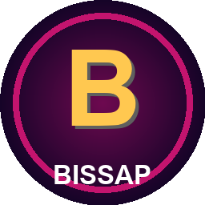

<p align="center">
  
</p>

<h1 align="center">Bissap Voice Changer</h1>

<p align="center">
  <b>Modificateur de voix temps réel et soundboard pour Discord, Teams, OBS</b>
</p>

<p align="center">
  
  
  
  
  
</p>

---

## En bref

Application de bureau qui capte le micro, applique une chaîne d'effets audio en temps réel et renvoie la voix modifiée vers un câble audio virtuel, que Discord ou OBS voient comme un micro.

- 🎛️ **29 effets DSP** codés avec NumPy/SciPy : pitch, formants, reverb, echo, chorus, flanger, phaser, vocoder, robot, radio, téléphone, sous l'eau, EQ, compresseur, noise gate, de-esser...
- 🔗 **Chaîne d'effets** combinables, réglables en direct, avec bouton bypass
- 🎭 **Profils** sauvegardés et activables par raccourci clavier pendant un appel
- 🎵 **Soundboard** avec raccourcis par son
- 🎧 **Retour casque** séparé et latence réglable

## Architecture

| Module | Rôle |
|--------|------|
| `audio_engine.py` | Flux audio micro → effets → câble virtuel, avec monitoring séparé (threads + file d'attente) |
| `effects.py` | Les 29 effets et la chaîne `EffectsChain` |
| `profile_manager.py` / `config_manager.py` | Sauvegarde des profils et de la configuration (JSON) |
| `soundboard_manager.py` | Lecture des sons et raccourcis |
| `main.py` | Interface CustomTkinter (onglets Voix / Profils / Soundboard) |

📖 Tutoriel détaillé : [TUTORIEL.md](TUTORIEL.md)

---

# Guide d'installation

Pas besoin d'être informaticien — suis juste les étapes dans l'ordre.

---

## C'est quoi exactement ?

C'est un programme qui :
- Capture ce que dit ton micro
- Applique des effets dessus (voix de robot, grave, chipmunk, écho, etc.)
- Envoie la voix modifiée à Discord / Teams / OBS à la place de ta vraie voix

---

## Ce qu'il te faut avant de commencer

### 1. Python
C'est le moteur qui fait tourner le programme.

1. Va sur **https://python.org** → clique sur "Download Python"
2. Lance l'installeur
3. **IMPORTANT** : coche la case **"Add Python to PATH"** avant de cliquer Installer
4. Clique Installer

### 2. Le programme lui-même
Double-clique sur **`install.bat`** dans le dossier du programme.  
Une fenêtre noire s'ouvre, attends qu'elle se ferme toute seule.

### 3. VB-Audio Virtual Cable (le "câble" qui relie tout)
C'est un petit driver gratuit qui fait croire à Discord que ton programme est un micro.  
**Sans ça, Discord entend ton vrai micro et pas les effets.**

1. Va sur **https://vb-audio.com/Cable**
2. Clique sur "Download VB-CABLE Driver"
3. Extrais le fichier ZIP téléchargé
4. Clic droit sur **`VBCABLE_Setup_x64.exe`** → **"Exécuter en tant qu'administrateur"**
5. Clique "Install Driver"
6. **Redémarre ton PC** (obligatoire, sinon ça marche pas)

---

## Lancement

Double-clique sur le raccourci **"Bissap Voice Changer"** sur ton bureau.  
L'application s'ouvre sans fenêtre noire.

---

## Configuration (à faire une seule fois)

Quand l'app est ouverte, dans l'onglet **"Modificateur de voix"** :

### Étape 1 — Identifier tes périphériques

Clique sur **"🔍 Tester périphériques"**.  
Une fenêtre s'ouvre avec deux colonnes :

- **Colonne gauche (micros)** : parle dans ton micro → regarde quel niveau monte → note le numéro entre crochets, par exemple `[3]`
- **Colonne droite (sorties)** : clique sur **"♪ Bip"** sur chaque ligne → écoute d'où vient le son → note le numéro de tes écouteurs/HP, par exemple `[1]`

### Étape 2 — Régler les 3 champs

| Champ | Ce qu'il faut mettre |
|---|---|
| 🎙 Micro (entrée) | Le numéro `[N]` de ton vrai micro trouvé à l'étape 1 |
| 🔌 Câble virtuel (sortie) | Le périphérique qui s'appelle **CABLE Input (VB-Audio)** |
| 🔊 Haut-parleurs (monitor) | Le numéro `[N]` de tes écouteurs/HP trouvé à l'étape 1 |

### Étape 3 — Appliquer

Clique sur **"⟳ Appliquer"**. Le statut passe à **"▶ Actif"** en vert.

### Étape 4 — Pour s'entendre soi-même

Coche la case **"🎧 S'entendre"**.  
⚠️ Utilise des **écouteurs** (pas des HP ouverts) sinon le micro capte le son qui sort et ça fait un écho.

### Étape 5 — Dans Discord

1. Discord → Paramètres (roue dentée) → **Voix et vidéo**
2. **Périphérique d'entrée** → sélectionne **"CABLE Output (VB-Audio Virtual Cable)"**
3. Désactive la "suppression du bruit" de Discord (elle déforme les effets)

---

## Utiliser les effets

Dans l'onglet **"Modificateur de voix"**, fais défiler vers le bas.  
Tu vois une liste d'effets (Pitch Shifter, Reverb, Echo, Robot...).

- **Clique sur le nom** d'un effet pour le déplier
- **Coche la case "ON"** pour l'activer
- **Bouge les sliders** pour régler l'intensité

Le bouton **"⊘ BYPASS"** coupe tous les effets d'un coup (ta vraie voix passe).

---

## Sauvegarder une configuration (Profils)

Onglet **"Profils"** :
1. Règle tes effets comme tu veux
2. Clique **"💾 Sauvegarder comme profil"**
3. Donne un nom

Tu peux assigner une touche (F1, F2...) à chaque profil pour switcher en direct pendant un appel.

---

## Soundboard

Onglet **"Soundboard"** :
- Clique **"✎"** sur un slot pour y mettre un fichier son
- Double-clique sur un slot pour jouer le son
- Tu peux aussi assigner une touche de raccourci par son

---

## Problèmes courants

### Je n'entends plus rien sur mon PC après avoir installé VB-Audio

VB-Audio a changé la sortie par défaut de Windows. Pour corriger :
1. Clic droit sur l'icône 🔊 dans la barre des tâches → **Paramètres du son**
2. Dans **"Sortie"**, remets tes vrais écouteurs ou haut-parleurs
3. Si ça ne suffit pas : appuie sur `Win + R`, tape `mmsys.cpl`, Entrée → onglet **Lecture** → clic droit sur tes HP → **"Définir en tant que périphérique par défaut"**

### Discord entend ma vraie voix sans effets

Dans Discord : Paramètres → Voix et vidéo → Périphérique d'entrée → vérifie que c'est bien **"CABLE Output (VB-Audio Virtual Cable)"** et pas ton vrai micro.

### J'entends un écho de ma voix en double

Deux causes possibles :
- Tu n'utilises pas d'écouteurs (le micro capte le son qui sort des HP)
- Windows a activé l'écoute du micro en arrière-plan : appuie sur `Win + R`, tape `mmsys.cpl`, Entrée → onglet **Enregistrement** → double-clique sur ton micro → onglet **"Écouter"** → décoche **"Écouter ce périphérique"**

### La voix est hachée / grésille

Dans la section **"Latence"**, passe à **2048** puis clique **⟳ Appliquer**.

### L'app ne démarre pas

Ouvre un terminal dans le dossier et tape :
```
python main.py
```
Lis le message d'erreur — il indique souvent qu'une dépendance manque. Lance `install.bat` à nouveau.

### Le câble VB-Audio n'apparaît pas dans la liste des périphériques

- Vérifie que l'installation a été faite **en administrateur**
- Redémarre Windows
- Clique **⟳ Appliquer** dans l'app pour rafraîchir la liste

---

## Désinstaller complètement

### 1. Supprimer le programme

Supprime simplement le dossier `voice_modifier` (ou là où tu l'as mis).

### 2. Supprimer les profils et la configuration sauvegardés

Appuie sur `Win + R`, colle ce chemin et appuie sur Entrée :
```
%USERPROFILE%\.voice_modifier
```
Supprime ce dossier entier.

### 3. Désinstaller VB-Audio Virtual Cable

1. Retourne dans le dossier où tu avais extrait le ZIP de VB-Audio
2. Clic droit sur **`VBCABLE_Setup_x64.exe`** → **"Exécuter en tant qu'administrateur"**
3. Clique **"Uninstall Driver"**
4. Redémarre le PC

### 4. Supprimer le raccourci bureau

Supprime le raccourci **"Bissap Voice Changer"** sur ton bureau.

### 5. Désinstaller Python (optionnel)

Si tu n'utilises Python pour rien d'autre :  
Paramètres Windows → Applications → recherche **"Python"** → Désinstaller.

---

Après ces 5 étapes, il ne reste absolument rien du programme sur ton PC.
